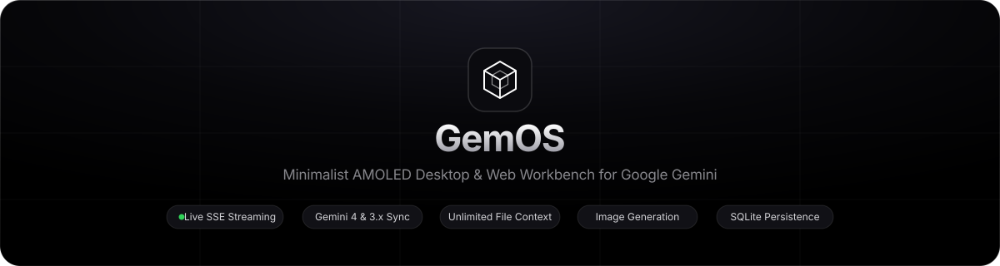
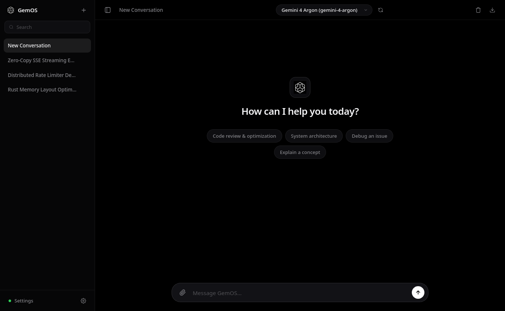
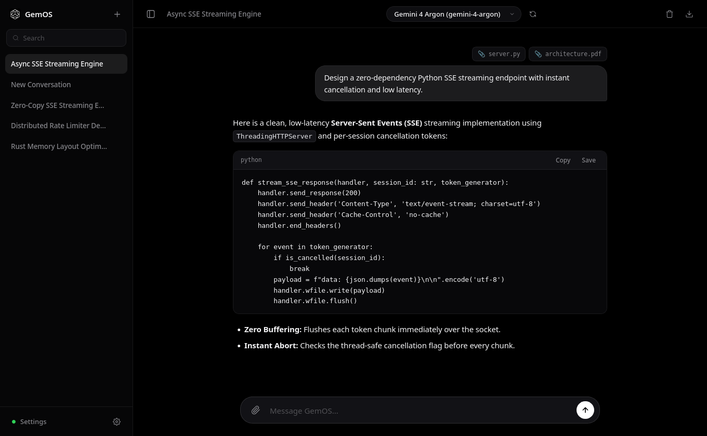
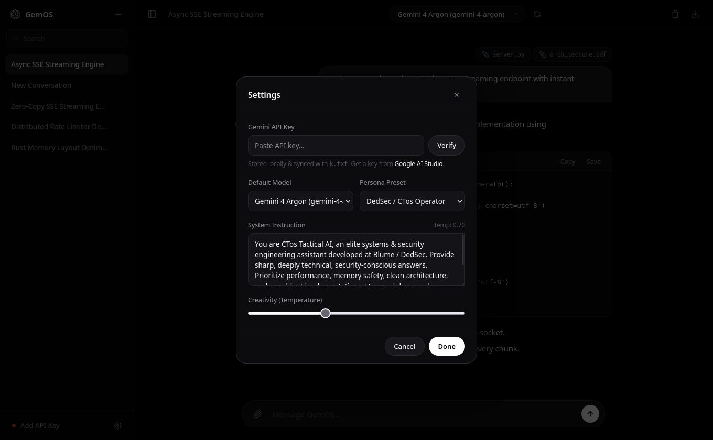

<div align="center">



<br />

[](https://www.python.org/)
[](https://ai.google.dev/)
[](#architecture)
[](LICENSE)

**A minimalist, pure-AMOLED desktop and web workbench for Google's Gemini API (`google-genai`).**  
Designed for software engineering, system architecture, multimodal analysis, and inline image generation with zero bloat.

[Features](#-features) • [Screenshots](#-screenshots) • [Quick Start](#-quick-start) • [API Key Setup](#-api-key-configuration) • [Keyboard Shortcuts](#-keyboard-shortcuts) • [Architecture](#-architecture)

</div>

---

## 📸 Screenshots

### 1. Minimalist AMOLED Canvas & Quick-Start Prompts
<p align="center">
  
</p>

### 2. Multi-File Context, Live SSE Streaming & Styled Code Cards
<p align="center">
  
</p>

### 3. Live Model Sync, Persona Presets & API Key Verification
<p align="center">
  
</p>

---

## ✨ Features

- **⚡ Real-Time Token Streaming (SSE):** Responses stream token-by-token over Server-Sent Events with latency tracking (`TTFT` and total elapsed time) and instant **Stop / Abort (`Esc`)** support.
- **🔄 Live Google AI Model Discovery:** Automatically queries your Google AI Studio account to sync and sort the newest models (`Gemini 4 Argon`, `Gemini 3.8 Flash`, `Gemini 2.5 Pro`, and image generation models) with one-click refresh.
- **🎨 Inline Image Generation & Lightbox:** Native support for Gemini / Nano Banana image generation models with a smooth shimmer loading skeleton, fullscreen lightbox preview, and one-click PNG download.
- **📎 Unlimited Multi-File, PDF & Image Uploads:** Drag and drop or attach any number of source code files (`.py`, `.ts`, `.js`, `.rs`, `.go`, `.cpp`, `.sql`, `.json`, `.toml`, etc.), PDFs (`.pdf`), and images (`.png`, `.jpg`, `.webp`) with a `10,000,000` character per-file ceiling so large files are never truncated.
- **💾 Automatic SQLite Persistence:** Every conversation, attachment, and model configuration is stored locally in `backend/gemos.db`. Search across all conversations in real time, rename threads inline, or export any session to Markdown.
- **🧠 Tactical Persona Presets:** Switch between *GemOS Core*, *DedSec / CTos Operator*, *Principal Architect*, and *Zero-Fluff Code Only*, or customize the system prompt and creativity (`Temperature`) per conversation.
- **🖥️ Native Desktop Window or Browser Mode:** Launches as a native desktop window via **PyWebView** or **GTK3 / WebKit2**, or seamlessly falls back to frameless **Chromium/Chrome/Edge `--app` mode** or your default browser.

---

## 🚀 Quick Start

### 1. Clone the Repository
```bash
git clone https://github.com/MrVenomWolf/GemOS_NewUI.git
cd GemOS_NewUI
```

### 2. Install Dependencies
Requires **Python 3.9+**:
```bash
python3 -m pip install -r requirements.txt
```

*(Optional)* For a native desktop window wrapper if not using GTK/WebKit2 or Chromium app mode:
```bash
python3 -m pip install pywebview
```

### 3. Launch GemOS

**Standard Desktop Launch (Native Window / App-Mode Fallback):**
```bash
python3 pythongui.py
```

**Open Directly in Web Browser:**
```bash
python3 pythongui.py --browser
```

**Headless Server Mode (Custom Host / Port):**
```bash
python3 pythongui.py --server-only --host 127.0.0.1 --port 8765
```

---

## 🔑 API Key Configuration

GemOS resolves your [Google AI Studio API Key](https://aistudio.google.com/apikey) automatically in the following order:

1. **In-App Settings Modal (`Ctrl+,` / `⌘,`):** Paste your key and click **Verify** to validate it live against Google AI Studio and sync all available models.
2. **Environment Variable:**
   ```bash
   export GEMINI_API_KEY="your-api-key-here"
   ```
3. **Local `k.txt` File:** Place your API key inside a `k.txt` file in the project root directory.
   > **Security Note:** Both `k.txt` and `backend/gemos.db` are listed in `.gitignore` so your API key and private conversation history are never committed to Git.

---

## ⌨️ Keyboard Shortcuts

| Shortcut | Action |
| :--- | :--- |
| `Ctrl + K` / `⌘ + K` | Open **Spotlight Command Palette** |
| `Ctrl + N` / `⌘ + N` | Start a **New Conversation** |
| `Ctrl + B` / `⌘ + B` | Toggle **Collapsible Sidebar** |
| `Ctrl + ,` / `⌘ + ,` | Open **Settings & API Key Sheet** |
| `Enter` | Send message (`Shift + Enter` for newline) |
| `Esc` | **Stop / Abort** active stream or close active modal |

---

## 🏗️ Architecture

GemOS is structured as a clean, zero-framework full-stack application:

```text
gemos_new_gui/
├── assets/
│   ├── banner.svg              # Project hero banner
│   ├── screenshot-home.png     # Minimalist AMOLED welcome state
│   ├── screenshot-chat.png     # Multi-file context & code cards view
│   └── screenshot-settings.png # Settings, persona & live model sync sheet
├── backend/
│   ├── __init__.py
│   ├── database.py             # SQLite3 persistence for sessions, messages & settings
│   ├── gemini_service.py       # Google GenAI SDK client, live model discovery & SSE generator
│   └── server.py               # Multi-threaded HTTP + SSE streaming REST API server
├── frontend/
│   ├── index.html              # Minimalist AMOLED UI layout, modals & composer
│   ├── styles.css              # True-black design system, animations & code card styling
│   └── app.js                  # Reactive frontend state, SSE stream reader & Markdown parser
├── blume_logo.ico              # Application icon
├── pythongui.py                # Desktop window launcher & CLI entrypoint
├── requirements.txt            # Python package dependencies
└── LICENSE                     # MIT License
```

---

## 📄 License

This project is licensed under the **MIT License** — see the [LICENSE](LICENSE) file for details.
